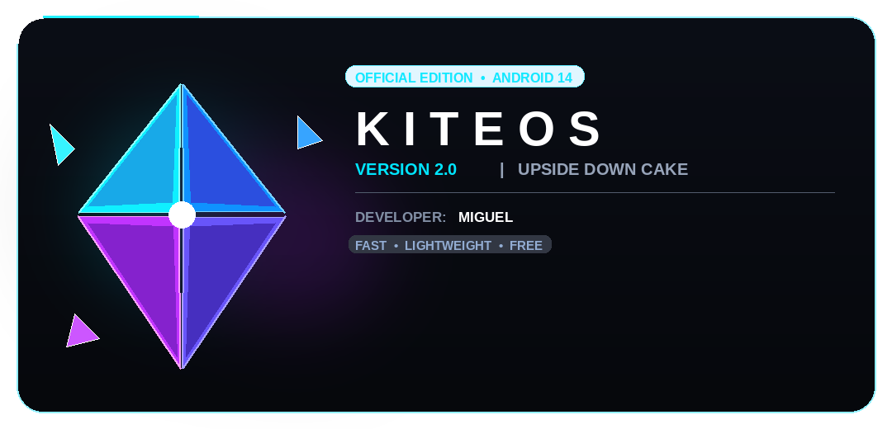
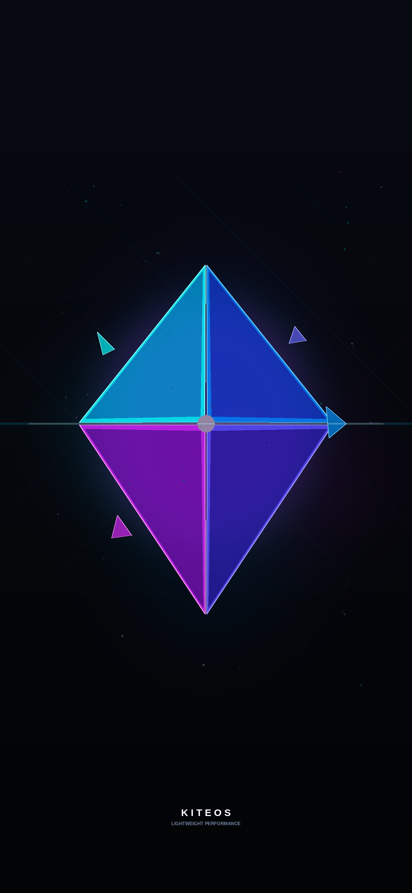

# 🪁 KiteOS 2.0

<p align="center">
  
</p>

<p align="center">
  <b>Fast • Lightweight • Free</b><br>
  <i>Custom Android Operating System based on LineageOS & AOSP</i>
</p>

<p align="center">
  
  
  
</p>

---

## 🗺️ Roadmap de Versões

| Versão KiteOS | Versão Android | Base AOSP / LineageOS | Codinome Android | Status |
| :--- | :--- | :--- | :--- | :--- |
| **KiteOS 1.0** | Android 13 | LineageOS 20.0 | *Tiramisu* | *Legacy (A Origem)* |
| **KiteOS 2.0** | Android 14 | LineageOS 21.0 | *Upside Down Cake* | **Atual (Em Desenvolvimento)** |
| **KiteOS 3.0** | Android 15 | LineageOS 22.0 | *Vanilla Ice Cream* | *Coming Soon* |
| **KiteOS 4.0** | Android 16 | LineageOS 23.0 | *Baklava* | *Planejado* |

---

## 🎨 Identidade Visual

### 1. Logo & Design Language
O símbolo do **KiteOS** é um prisma geométrico multifacetado em 4 tons vibrantes:
* **Top-Left:** Neon Cyan (`#00f0ff`)
* **Top-Right:** Electric Azure (`#0066ff`)
* **Bottom-Left:** Vivid Neon Violet / Magenta (`#b5179e`)
* **Bottom-Right:** Deep Royal Indigo (`#3a0ca3`)

### 2. Bootanimation Oficial
* **Arquivo:** `bootanimation/bootanimation.zip`
* **Resolução:** 1080 x 1920 @ 30 FPS
* **Part 0 (Intro):** Prisma em 3D surgindo suavemente e iluminando os contornos, com entrada da tipografia `K I T E O S`.
* **Part 1 (Loop):** Pulsação suave com reflexo luminoso contínuo enquanto o sistema carrega.
* **Preview:** `bootanimation/preview.mp4`

### 3. Papel de Parede Padrão (Ultra HD)
* **Arquivo:** `wallpapers/kiteos_default_wallpaper.png` e `default_wallpaper.jpg`
* **Resolução:** 1440 x 3120 (19.5:9 Ultra HD)
* **Otimização:** Fundo preto profundo para telas OLED/AMOLED com excelente contraste para os ícones e widgets.

<p align="center">
  
</p>

---

## ⚙️ Compilação e Testes (Emulador Android)

Para compilar a ROM para o emulador Android x86_64:

```bash
# 1. Carregar variáveis de ambiente
source build/envsetup.sh

# 2. Selecionar o alvo do emulador
lunch lineage_x86_64-userdebug

# 3. Compilar
m -j$(nproc --all)

# 4. Iniciar o emulador
emulator
```

---

<p align="center">
  Criado por <b>Miguel</b> • KiteOS Project
</p>
